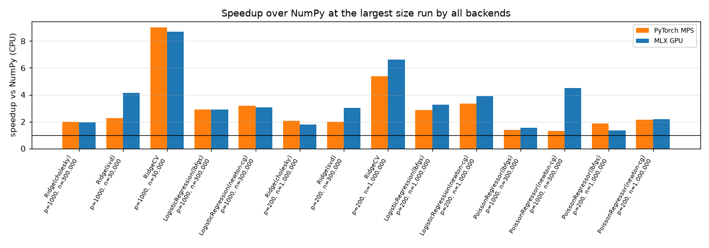
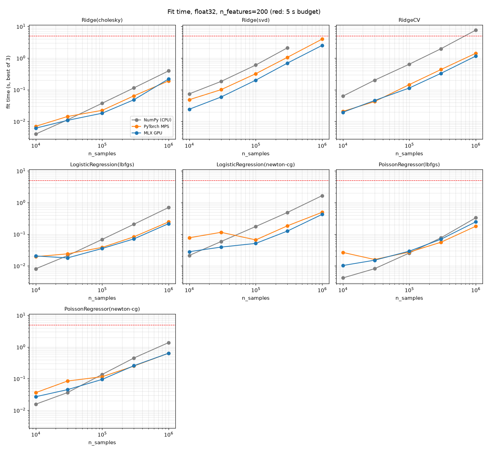
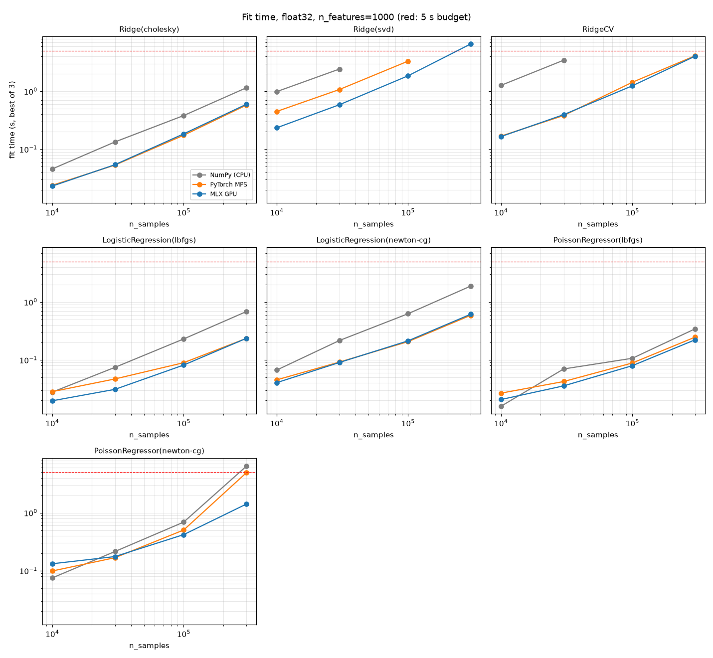
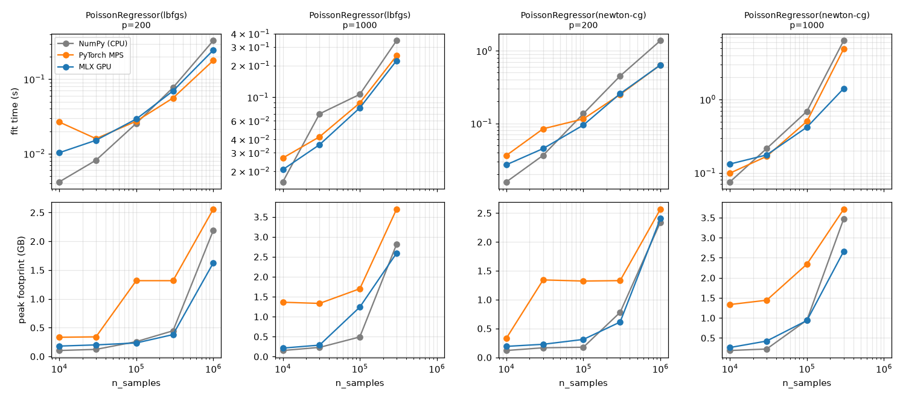

> This report includes code written with the assistance of AI.
> The code has **not yet been reviewed** by a human.

**Setup**: Apple M4, 32 GB unified memory, macOS 26.6.2; Python 3.14.10, NumPy 2.5.5, SciPy 1.18.1, PyTorch 2.14.1, MLX 0.32.4, scikit-learn 1.10.dev0 (this branch).

## TL;DR

- **All 25 estimators tagged `array_api_support`** work with MLX arrays
  under `sklearn.set_config(array_api_dispatch=True)`, on both the
  `"gpu"` (float32) and `"cpu"` (float64) devices. So do
  `GaussianMixture`, the calibration helpers, and the array API metrics.
  The whole `pytest sklearn -k mlx` selection passes: 1647 passed,
  15 skipped. Peak memory during the run was 0.6 GB.
- The changes don't regress the other namespaces. All
  `array_api or torch or strict` tests pass, as do the full test files of
  every touched module, apart from 18 pre-existing torch MPS failures
  (`torch.unique` does not support unsigned dtypes on MPS).
- For matmul-bound solvers (`Ridge(solver="cholesky")`, `LogisticRegression`
  lbfgs and newton-cg, `RidgeCV` at p=1000), MLX on the GPU is
  **0.87–1.16x the speed of PyTorch MPS**, so roughly on par. Against
  NumPy on the 10-core CPU, both GPU backends are 1.8–4x faster for
  cholesky and logistic regression, and 6.6–8.7x faster for `RidgeCV`.
- For SVD-based solvers, MLX is **1.5–1.8x faster than torch MPS**:
  `Ridge(solver="svd")`, and `RidgeCV` at p=200 (1.23x). This is despite
  MLX linalg running on the CPU stream. The gain mostly comes from the
  QR-first thin SVD, see below.
- **Memory**: the MLX process baseline is about 0.2 GB, against about
  0.35–1.35 GB for torch MPS. MLX peaks are much lower for SVD-based
  solvers. For example, `Ridge(svd)` at p=200, n=1M peaks at 3.2 GB on MLX
  against 6.3 GB on torch. For the largest cholesky and logistic runs, the
  peaks are similar, and somewhat higher for MLX `Ridge(cholesky)`.
- MLX support required:
  - a new `array_api_compat.mlx` wrapper (about 1250 lines);
  - a new `array_api_extra.compress` helper and a few small
    `array_api_extra` fixes;
  - about 30 small, namespace-agnostic rewrites in scikit-learn, mostly
    replacing boolean-mask indexing, see below.
- **Correction to the first version of this report.** The NumPy baseline
  numbers in that version were wrong. The editable scikit-learn build was
  linked against Homebrew's `libomp`, while conda's OpenBLAS loaded conda's
  `libomp`. Having two OpenMP runtimes in one process slowed down the
  OpenMP-parallel NumPy path (`LogisticRegression` at p=200: 1.9 s, against
  0.7 s now) and segfaulted `PoissonRegressor`. Rebuilding with the
  conda-forge compilers fixed this, and all numbers below come from the
  rebuilt version.
- **PoissonRegressor** (`lbfgs`, `newton-cg`; see the dedicated section
  below): MLX is on par with torch MPS for `lbfgs` (0.73-1.29x, best at
  small and medium sizes, slower at p=200 with 1M samples) and
  1.0-1.9x faster than torch for `newton-cg` in most configurations, up to
  3.5x at p=1000 with 300k samples. Scores are identical across backends.

## Methodology

- Synthetic float32 data. Regression is a linear model plus noise.
  Classification has 3 classes, sampled from the argmax of logits plus
  Gumbel noise. Poisson targets are drawn from `Poisson(exp(0.5 + X @ w))`
  with `w ~ N(0, 1/n_features)`. `n_features` is 200 or 1000, and `n_samples` takes values
  from 10k up to 1M.
- Each (estimator, backend, n_samples) configuration runs in **its own
  process** under an external watchdog (`tmp_mlx_benchmark/scripts/watchdog.py`). The
  watchdog SIGKILLs the process tree if any of these happen:
  - the wall time exceeds 60 s;
  - the macOS *physical footprint* exceeds 8 GB. The footprint is read with
    `proc_pid_rusage(...).ri_phys_footprint`, which, unlike RSS, includes
    Metal/GPU buffers in unified memory;
  - system available memory drops below 5 GB.
- In-process caps: `mx.set_memory_limit(6 GB)`, `mx.set_cache_limit(1 GB)`,
  and `torch.mps.set_per_process_memory_fraction`.
- The driver skips sizes whose predicted fit time (extrapolated linearly
  from the previous size) exceeds 7 s, or whose raw `X` would exceed
  1.5 GB. It stops a backend's sweep as soon as one fit takes more than 5 s.
  No run was killed in either sweep.
- Each configuration does one warm-up fit on a 2000-sample problem
  (kernel compilation and caches), then up to 3 timed fits. The best time
  is reported. The fitted attributes are synchronised (`mx.eval` /
  `torch.mps.synchronize()`) before the clock stops. Host-to-device
  transfer time is measured separately (`transfer_s`) and is not included
  in the fit time.
- Solver settings: `RidgeCV(alphas=np.logspace(-3, 3, 10))` uses the
  default efficient leave-one-out (GCV) path. `LogisticRegression` uses the
  default `C=1.0` and `tol`.

## PoissonRegressor

Only `solver="lbfgs"` (the `"auto"` choice for `l1_ratio == 0`) and
`solver="newton-cg"` support array API inputs. `newton-cholesky`,
`newton-cd` and `newton-cd-gram` still convert to NumPy internally, and
fail on torch MPS arrays as well as on MLX arrays. They are not benchmarked.
Default parameters are used (`alpha=1`, `tol=1e-4`, `max_iter=100`).

Fit time in seconds (best of 3) and MLX speedup over torch MPS. "hessp" is
the number of Hessian-vector products, i.e. the number of inner conjugate
gradient iterations of `newton-cg`. It is identical across backends except
where noted, which confirms that the three backends follow the same
optimization path.

| solver | p | n_samples | NumPy | torch MPS | MLX | MLX vs MPS |
|---|---|---|---|---|---|---|
| lbfgs | 200 | 10k | 0.004 | 0.027 | 0.010 | 2.59x |
| lbfgs | 200 | 100k | 0.026 | 0.027 | 0.029 | 0.93x |
| lbfgs | 200 | 300k | 0.077 | 0.056 | 0.070 | 0.80x |
| lbfgs | 200 | 1M | 0.330 | 0.179 | 0.246 | 0.73x |
| lbfgs | 1000 | 10k | 0.016 | 0.027 | 0.021 | 1.29x |
| lbfgs | 1000 | 100k | 0.107 | 0.089 | 0.080 | 1.11x |
| lbfgs | 1000 | 300k | 0.344 | 0.247 | 0.223 | 1.11x |
| newton-cg | 200 | 10k | 0.016 | 0.036 | 0.027 | 1.34x |
| newton-cg | 200 | 100k | 0.136 | 0.115 | 0.095 | 1.22x |
| newton-cg | 200 | 300k | 0.450 | 0.250 | 0.257 | 0.97x |
| newton-cg | 200 | 1M | 1.380 | 0.638 | 0.637 | 1.00x |
| newton-cg | 1000 | 10k | 0.075 | 0.099 | 0.132 | 0.75x |
| newton-cg | 1000 | 100k | 0.689 | 0.503 | 0.419 | 1.20x |
| newton-cg | 1000 | 300k | 6.339 | 4.892 | 1.410 | 3.47x |

(All rows except the last: `n_iter_` is identical on the three backends.
Train scores agree to 4 digits. Intermediate sizes are in the raw results.)

Observations:

- `lbfgs` does very little work per iteration (one loss + gradient
  evaluation, 6-9 iterations), and scipy's L-BFGS-B runs on the host, so
  each iteration forces a device sync and a device-to-host copy of the
  gradient. Fit times are therefore dominated by dispatch and sync latency
  at small n, where MLX has lower overhead than torch MPS (2.6x faster at
  p=200, n=10k). At p=200 and large n (>= 300k) torch MPS is faster (MLX
  is 0.73x at 1M samples); at p=1000 MLX is 1.1x faster. We did not
  investigate the p=200 large-n gap.
- `newton-cg` is dominated by the Hessian-vector products (`X.T @ (w * (X @ s))`).
  MLX and torch MPS are on par at p=200 for n >= 300k, and MLX is 1.2x
  faster at 100k. It is slower at p=1000, n=10k (0.75x), where the problem
  is too small for the GPU to help over NumPy for either backend.
- **The 3.5x at p=1000, n=300k is partly an artifact.** NumPy and torch MPS
  needed 14 Hessian-vector products (8 outer iterations), while MLX needed
  11 (7 outer iterations), most likely because float32 rounding differences
  changed the CG trajectory. Normalized per Hessian-vector product, the
  speedup is 2.7x (128 ms for MLX, 350 ms for torch MPS, 453 ms for
  NumPy). The time per product for NumPy and torch MPS also increases
  sharply between 100k (46 ms for torch MPS) and 300k samples (350 ms),
  while MLX scales roughly linearly. This was reproduced in two separate
  sweeps. It is not explained by the iteration counts. The extra cost may
  come from line-search loss / gradient evaluations, which are not counted,
  but we did not verify it. The 100k point (1.2x vs torch MPS, 1.6x vs
  NumPy) is the more reliable comparison.
- Memory: MLX peaks are lower than or similar to torch MPS in all
  configurations (for example 2.7 GB vs 3.7 GB at p=1000, n=300k, and
  1.6 GB vs 2.6 GB for `lbfgs` at p=200, n=1M). The torch MPS baseline is
  about 1.3 GB as soon as its allocator is warmed up at 30k-100k samples.

## How MLX support works

MLX (`mlx.core`) is close to the array API but differs in several ways
that matter to scikit-learn. All of these are handled in the vendored
`array_api_compat.mlx` wrapper unless noted otherwise:

| MLX gap | Workaround |
|---|---|
| No boolean-mask indexing (`x[mask]`) | `xp.where` rewrites in sklearn; new `xpx.compress(cond, x, axis=)` (take + nonzero); `xpx.at(...).set` converts boolean masks |
| No device on arrays; devices are not picklable/deep-copyable; `Device == None` and `Dtype == None` raise | Devices exposed as the strings `"cpu"` / `"gpu"` (the current default device); mapped to `stream=` internally |
| float64 is CPU only, and the GPU fails late with an obscure error | Eager `TypeError` on GPU float64 (same as torch MPS); `info.dtypes(device="gpu")` omits float64 so `move_to` downcasts |
| float64 `exp`, `sin`, `cos`, `logaddexp` on the CPU device are not accurate to float64 precision | Route to NumPy for float64 inputs; this fixed a 5e-3 relative coefficient error in float64 `LogisticRegression` |
| `linalg` is CPU-stream only, lazy, and errors surface at `eval` time; non-PD `cholesky` silently returns garbage | Run on `mx.cpu`, `mx.eval` eagerly, raise `LinAlgError`; explicit positive-diagonal check after cholesky |
| `svd` has no `full_matrices=False` (full `U` is O(n²) memory: this is what crashed a previous iteration) | Thin SVD emulated via QR followed by SVD of the small R factor |
| No `nonzero`, `unique_*`, `det`, `slogdet`, `nextafter`; data-dependent shapes | Round-trip through NumPy on the host |
| Default integer dtype is int32; `argmax`/`argsort` return uint32 | Cast to int32 (index dtype reported as int32) |
| Missing or differently named keywords: `correction`, `include_initial`, `descending`, `stable`, `copy`, `device`, `dtype` on reductions, `prepend`/`append`, ... | Thin wrappers |
| `mx.array(x)` silently downcasts float64 inputs, including NumPy scalars such as `np.float64`; `from_dlpack` does too | Dtype-preserving `asarray` from foreign arrays and NumPy scalars |
| Basic indexing returns copies, not views | Fixed the one sklearn call site (`GaussianMixture`) that relied on mutating a view |
| Streams are thread-local: a lazy array built in one thread cannot be evaluated in another | Skip host threading for MLX in `_parallel_pairwise` (new `_supports_threading(xp)` helper) |
| `mlx.core.array.__array_namespace__` returns raw `mlx.core`, so SciPy's array API dispatch uses it and fails | New `_scipy_supports_namespace(xp)` helper; array API fallbacks for `trapezoid` (`auc`) and `gmean` (multinomial link); `_xlogy` for `HalfPoissonLoss` |

Changes needed in scikit-learn itself. All of them are namespace-agnostic,
and the NumPy, array-api-strict and torch tests still pass:

- **Boolean-mask indexing.** Rewritten with `xp.where` or `xpx.compress`
  in:
  - `_ridge._solve_svd`, `_encode._check_unknown`, and `label_binarize`;
  - `r2_score` / `d2_*`, `multilabel_confusion_matrix`, and
    `balanced_accuracy_score`;
  - `roc_curve` and the threshold computation shared by the ranking
    metrics;
  - `calinski_harabasz_score` and `davies_bouldin_score`;
  - `_weighted_percentile`, `_incremental_mean_and_var`, and `_nanaverage`;
  - `_safe_indexing` with boolean keys;
  - `GaussianNB.partial_fit`;
  - `LinearDiscriminantAnalysis`: class means, the `svd` solver, and
    `predict_log_proba`;
  - `LogisticRegressionCV`: the `Cs_` reciprocals.
- **0-d arrays used as slice bounds or Python ints.** MLX rejects them.
  Wrapped with `int(...)` in `det_curve`, partial `roc_auc_score`, the LDA
  rank, `PCA` with a float `n_components`, and `PCA(n_components="mle")`.
- **Float dtypes.** `confusion_matrix` used to pick its float accumulator
  with a hard-coded `str(device).startswith("mps")` check, and now uses
  `_max_precision_float_dtype`. The `_bincount` NumPy fallback for
  weighted counts uses the same helper.
- **Latent bug.** `LogisticRegressionCV.l1_ratio_` was created without
  `device` / `dtype`. This also affects torch.
- **Tests.**
  - `yield_namespaces` gains `("mlx.core", "gpu", "float32")` and
    `("mlx.core", "cpu", "float64")`.
  - A few tests compared `x.device` attributes and now use
    `array_device`.
  - `check_array_api_input` skips the dispatch-disabled NumPy-indexing
    smoke test for MLX, as it already does for array-api-strict.

## Things worth reporting upstream

- **MLX**:
  - float64 accuracy of `exp`, `sin`, `cos`, `erf`, `erfinv`, `sigmoid`,
    `logsumexp`, `logaddexp`, and `softmax` on the CPU: about 1e-7 relative
    error, see `tmp_mlx_benchmark/scripts/audit_float64.py`;
  - `mx.array` / `from_dlpack` downcasting float64;
  - `__array_namespace__` advertising non-compliant `mlx.core`;
  - `Device` / `Dtype` `__eq__(None)` raising;
  - `Device` not picklable;
  - `svd(full_matrices=False)` missing;
  - silent garbage from non-PD `cholesky`;
  - lazy linalg errors;
  - boolean-mask indexing missing.
- **array-api-compat**: the new `mlx` wrapper as a whole, plus
  `is_mlx_array` / `is_mlx_namespace`.
- **array-api-extra**:
  - `compress`;
  - the `at` boolean-mask path for namespaces without boolean indexing;
  - `setdiff1d` without boolean indexing.
- **SciPy**: array API dispatch for MLX would require SciPy's vendored
  array-api-compat to include the new wrapper.

## Caveats

- MLX has no per-array device. An MLX "device" in scikit-learn is the
  process-wide default device at the time of the call. Mixing CPU and GPU
  MLX arrays in one process is therefore not meaningfully supported.
- Linear algebra (cholesky, eigh, qr, svd) runs on the MLX CPU stream, not
  the GPU. The MLX `Ridge(svd)` and `RidgeCV` speedups come from the GPU
  matmuls around the decomposition and from the QR-first thin SVD trick.
- Three runs exceeded the 5 s budget: NumPy `RidgeCV` at p=200, n=1M
  (7.7 s), MLX `Ridge(svd)` at p=1000, n=300k (6.6 s), and NumPy
  `PoissonRegressor(newton-cg)` at p=1000, n=300k (6.3 s). The linear
  extrapolation from the previous size predicted less than 7 s, so the
  driver allowed them.
- At small n (≤ 30k), the GPU timings are dominated by dispatch overhead
  and are noisy. For example, torch newton-cg at p=200 is slower at
  n=30k (0.115 s) than at n=100k (0.066 s).
- Only 7 estimator configurations (Ridge cholesky / svd, RidgeCV,
  LogisticRegression lbfgs / newton-cg, PoissonRegressor lbfgs / newton-cg)
  were benchmarked. The other
  array API estimators were validated for correctness by the test suite,
  but not timed.

## Summary at the largest size run by all backends

Times are best-of-3 `fit` wall-clock seconds, after a warm-up fit and with an explicit device sync (`mx.eval` / `torch.mps.synchronize`). Footprint is the peak physical footprint of the benchmark process (includes GPU allocations in unified memory) sampled every 100 ms by the external watchdog.

| estimator | n_features | n_samples | numpy_s | torch_mps_s | mlx_s | mlx_vs_mps | mlx_vs_numpy | mps_footprint_gb | mlx_footprint_gb |
|---|---|---|---|---|---|---|---|---|---|
| Ridge(cholesky) | 1000 | 300,000 | 1.148 | 0.576 | 0.596 | 0.97 | 1.93 | 3.74 | 4.64 |
| Ridge(svd) | 1000 | 30,000 | 2.413 | 1.071 | 0.585 | 1.83 | 4.13 | 1.70 | 0.66 |
| RidgeCV | 1000 | 30,000 | 3.436 | 0.382 | 0.395 | 0.97 | 8.70 | 1.37 | 0.66 |
| LogisticRegression(lbfgs) | 1000 | 300,000 | 0.683 | 0.235 | 0.236 | 1.00 | 2.90 | 3.76 | 3.56 |
| LogisticRegression(newton-cg) | 1000 | 300,000 | 1.883 | 0.589 | 0.615 | 0.96 | 3.06 | 3.76 | 3.70 |
| Ridge(cholesky) | 200 | 1,000,000 | 0.396 | 0.191 | 0.220 | 0.87 | 1.80 | 2.61 | 3.17 |
| Ridge(svd) | 200 | 300,000 | 2.118 | 1.061 | 0.697 | 1.52 | 3.04 | 2.54 | 1.07 |
| RidgeCV | 200 | 1,000,000 | 7.666 | 1.422 | 1.158 | 1.23 | 6.62 | 3.42 | 3.18 |
| LogisticRegression(lbfgs) | 200 | 1,000,000 | 0.701 | 0.245 | 0.216 | 1.14 | 3.24 | 2.59 | 2.47 |
| LogisticRegression(newton-cg) | 200 | 1,000,000 | 1.658 | 0.494 | 0.424 | 1.16 | 3.91 | 2.34 | 2.45 |
| PoissonRegressor(lbfgs) | 1000 | 300,000 | 0.344 | 0.247 | 0.223 | 1.11 | 1.55 | 3.69 | 2.59 |
| PoissonRegressor(newton-cg) | 1000 | 300,000 | 6.339 | 4.892 | 1.410 | 3.47 | 4.49 | 3.71 | 2.66 |
| PoissonRegressor(lbfgs) | 200 | 1,000,000 | 0.330 | 0.179 | 0.246 | 0.73 | 1.34 | 2.56 | 1.62 |
| PoissonRegressor(newton-cg) | 200 | 1,000,000 | 1.380 | 0.638 | 0.637 | 1.00 | 2.17 | 2.57 | 2.40 |

## Fit time vs. number of samples

## PoissonRegressor: time and memory

## Raw results

| estimator | backend | n_features | n_samples | fit_time_s | transfer_s | n_iter | n_hessp | train_score | peak_footprint_gb |
|---|---|---|---|---|---|---|---|---|---|
| Ridge(cholesky) | numpy | 1000 | 10,000 | 0.046 | 0.000 |  |  | 0.9991 | 0.15 |
| Ridge(cholesky) | numpy | 1000 | 30,000 | 0.134 | 0.000 |  |  | 0.9991 | 0.34 |
| Ridge(cholesky) | numpy | 1000 | 100,000 | 0.381 | 0.000 |  |  | 0.9990 | 0.86 |
| Ridge(cholesky) | numpy | 1000 | 300,000 | 1.148 | 0.000 |  |  | 0.9990 | 2.36 |
| Ridge(cholesky) | torch-mps | 1000 | 10,000 | 0.024 | 0.026 |  |  | 0.9991 | 1.35 |
| Ridge(cholesky) | torch-mps | 1000 | 30,000 | 0.053 | 0.029 |  |  | 0.9991 | 1.46 |
| Ridge(cholesky) | torch-mps | 1000 | 100,000 | 0.174 | 0.039 |  |  | 0.9990 | 2.35 |
| Ridge(cholesky) | torch-mps | 1000 | 300,000 | 0.576 | 0.068 |  |  | 0.9990 | 3.74 |
| Ridge(cholesky) | mlx-gpu | 1000 | 10,000 | 0.023 | 0.002 |  |  | 0.9991 | 0.35 |
| Ridge(cholesky) | mlx-gpu | 1000 | 30,000 | 0.054 | 0.007 |  |  | 0.9991 | 0.65 |
| Ridge(cholesky) | mlx-gpu | 1000 | 100,000 | 0.184 | 0.021 |  |  | 0.9990 | 1.70 |
| Ridge(cholesky) | mlx-gpu | 1000 | 300,000 | 0.596 | 0.063 |  |  | 0.9990 | 4.64 |
| Ridge(svd) | numpy | 1000 | 10,000 | 0.985 | 0.000 |  |  | 0.9991 | 0.41 |
| Ridge(svd) | numpy | 1000 | 30,000 | 2.413 | 0.000 |  |  | 0.9991 | 1.04 |
| Ridge(svd) | torch-mps | 1000 | 10,000 | 0.448 | 0.031 |  |  | 0.9991 | 1.49 |
| Ridge(svd) | torch-mps | 1000 | 30,000 | 1.071 | 0.028 |  |  | 0.9991 | 1.70 |
| Ridge(svd) | torch-mps | 1000 | 100,000 | 3.306 | 0.038 |  |  | 0.9990 | 3.74 |
| Ridge(svd) | mlx-gpu | 1000 | 10,000 | 0.234 | 0.002 |  |  | 0.9991 | 0.37 |
| Ridge(svd) | mlx-gpu | 1000 | 30,000 | 0.585 | 0.007 |  |  | 0.9991 | 0.66 |
| Ridge(svd) | mlx-gpu | 1000 | 100,000 | 1.846 | 0.022 |  |  | 0.9990 | 1.71 |
| Ridge(svd) | mlx-gpu | 1000 | 300,000 | 6.551 | 0.069 |  |  | 0.9990 | 4.69 |
| RidgeCV | numpy | 1000 | 10,000 | 1.265 | 0.000 |  |  | 0.9991 | 0.29 |
| RidgeCV | numpy | 1000 | 30,000 | 3.436 | 0.000 |  |  | 0.9991 | 0.70 |
| RidgeCV | torch-mps | 1000 | 10,000 | 0.168 | 0.025 |  |  | 0.9991 | 1.36 |
| RidgeCV | torch-mps | 1000 | 30,000 | 0.382 | 0.028 |  |  | 0.9991 | 1.37 |
| RidgeCV | torch-mps | 1000 | 100,000 | 1.430 | 0.046 |  |  | 0.9990 | 2.43 |
| RidgeCV | torch-mps | 1000 | 300,000 | 4.091 | 0.070 |  |  | 0.9990 | 4.95 |
| RidgeCV | mlx-gpu | 1000 | 10,000 | 0.165 | 0.002 |  |  | 0.9991 | 0.36 |
| RidgeCV | mlx-gpu | 1000 | 30,000 | 0.395 | 0.007 |  |  | 0.9991 | 0.66 |
| RidgeCV | mlx-gpu | 1000 | 100,000 | 1.243 | 0.022 |  |  | 0.9990 | 1.71 |
| RidgeCV | mlx-gpu | 1000 | 300,000 | 4.024 | 0.065 |  |  | 0.9990 | 4.69 |
| LogisticRegression(lbfgs) | numpy | 1000 | 10,000 | 0.028 | 0.000 | 7.000 |  | 0.6567 | 0.20 |
| LogisticRegression(lbfgs) | numpy | 1000 | 30,000 | 0.075 | 0.000 | 6.000 |  | 0.6198 | 0.36 |
| LogisticRegression(lbfgs) | numpy | 1000 | 100,000 | 0.230 | 0.000 | 6.000 |  | 0.6012 | 0.72 |
| LogisticRegression(lbfgs) | numpy | 1000 | 300,000 | 0.683 | 0.000 | 6.000 |  | 0.6000 | 3.64 |
| LogisticRegression(lbfgs) | torch-mps | 1000 | 10,000 | 0.028 | 0.026 | 7.000 |  | 0.6567 | 1.38 |
| LogisticRegression(lbfgs) | torch-mps | 1000 | 30,000 | 0.047 | 0.030 | 6.000 |  | 0.6198 | 1.40 |
| LogisticRegression(lbfgs) | torch-mps | 1000 | 100,000 | 0.090 | 0.038 | 6.000 |  | 0.6012 | 1.41 |
| LogisticRegression(lbfgs) | torch-mps | 1000 | 300,000 | 0.235 | 0.067 | 6.000 |  | 0.6000 | 3.76 |
| LogisticRegression(lbfgs) | mlx-gpu | 1000 | 10,000 | 0.020 | 0.002 | 7.000 |  | 0.6567 | 0.25 |
| LogisticRegression(lbfgs) | mlx-gpu | 1000 | 30,000 | 0.031 | 0.007 | 6.000 |  | 0.6198 | 0.45 |
| LogisticRegression(lbfgs) | mlx-gpu | 1000 | 100,000 | 0.082 | 0.021 | 6.000 |  | 0.6012 | 1.40 |
| LogisticRegression(lbfgs) | mlx-gpu | 1000 | 300,000 | 0.236 | 0.079 | 6.000 |  | 0.6000 | 3.56 |
| LogisticRegression(newton-cg) | numpy | 1000 | 10,000 | 0.067 | 0.000 | 5.000 |  | 0.6564 | 0.20 |
| LogisticRegression(newton-cg) | numpy | 1000 | 30,000 | 0.216 | 0.000 | 6.000 |  | 0.6199 | 0.35 |
| LogisticRegression(newton-cg) | numpy | 1000 | 100,000 | 0.627 | 0.000 | 5.000 |  | 0.6012 | 0.84 |
| LogisticRegression(newton-cg) | numpy | 1000 | 300,000 | 1.883 | 0.000 | 5.000 |  | 0.6000 | 3.64 |
| LogisticRegression(newton-cg) | torch-mps | 1000 | 10,000 | 0.045 | 0.027 | 5.000 |  | 0.6564 | 1.38 |
| LogisticRegression(newton-cg) | torch-mps | 1000 | 30,000 | 0.092 | 0.031 | 6.000 |  | 0.6199 | 1.40 |
| LogisticRegression(newton-cg) | torch-mps | 1000 | 100,000 | 0.207 | 0.037 | 5.000 |  | 0.6011 | 1.52 |
| LogisticRegression(newton-cg) | torch-mps | 1000 | 300,000 | 0.589 | 0.066 | 5.000 |  | 0.6000 | 3.76 |
| LogisticRegression(newton-cg) | mlx-gpu | 1000 | 10,000 | 0.041 | 0.002 | 5.000 |  | 0.6564 | 0.25 |
| LogisticRegression(newton-cg) | mlx-gpu | 1000 | 30,000 | 0.090 | 0.007 | 6.000 |  | 0.6199 | 0.41 |
| LogisticRegression(newton-cg) | mlx-gpu | 1000 | 100,000 | 0.214 | 0.021 | 5.000 |  | 0.6011 | 1.46 |
| LogisticRegression(newton-cg) | mlx-gpu | 1000 | 300,000 | 0.615 | 0.075 | 5.000 |  | 0.6000 | 3.70 |
| Ridge(cholesky) | numpy | 200 | 10,000 | 0.004 | 0.000 |  |  | 0.9955 | 0.10 |
| Ridge(cholesky) | numpy | 200 | 30,000 | 0.011 | 0.000 |  |  | 0.9960 | 0.12 |
| Ridge(cholesky) | numpy | 200 | 100,000 | 0.038 | 0.000 |  |  | 0.9942 | 0.25 |
| Ridge(cholesky) | numpy | 200 | 300,000 | 0.115 | 0.000 |  |  | 0.9950 | 0.33 |
| Ridge(cholesky) | numpy | 200 | 1,000,000 | 0.396 | 0.000 |  |  | 0.9951 | 1.60 |
| Ridge(cholesky) | torch-mps | 200 | 10,000 | 0.007 | 0.001 |  |  | 0.9955 | 0.32 |
| Ridge(cholesky) | torch-mps | 200 | 30,000 | 0.014 | 0.003 |  |  | 0.9960 | 1.34 |
| Ridge(cholesky) | torch-mps | 200 | 100,000 | 0.022 | 0.030 |  |  | 0.9942 | 1.33 |
| Ridge(cholesky) | torch-mps | 200 | 300,000 | 0.064 | 0.050 |  |  | 0.9950 | 1.34 |
| Ridge(cholesky) | torch-mps | 200 | 1,000,000 | 0.191 | 0.048 |  |  | 0.9951 | 2.61 |
| Ridge(cholesky) | mlx-gpu | 200 | 10,000 | 0.006 | 0.000 |  |  | 0.9955 | 0.19 |
| Ridge(cholesky) | mlx-gpu | 200 | 30,000 | 0.011 | 0.001 |  |  | 0.9960 | 0.28 |
| Ridge(cholesky) | mlx-gpu | 200 | 100,000 | 0.018 | 0.005 |  |  | 0.9942 | 0.47 |
| Ridge(cholesky) | mlx-gpu | 200 | 300,000 | 0.048 | 0.015 |  |  | 0.9950 | 1.07 |
| Ridge(cholesky) | mlx-gpu | 200 | 1,000,000 | 0.220 | 0.043 |  |  | 0.9951 | 3.17 |
| Ridge(svd) | numpy | 200 | 10,000 | 0.075 | 0.000 |  |  | 0.9955 | 0.14 |
| Ridge(svd) | numpy | 200 | 30,000 | 0.183 | 0.000 |  |  | 0.9960 | 0.24 |
| Ridge(svd) | numpy | 200 | 100,000 | 0.605 | 0.000 |  |  | 0.9942 | 0.85 |
| Ridge(svd) | numpy | 200 | 300,000 | 2.118 | 0.000 |  |  | 0.9950 | 2.35 |
| Ridge(svd) | torch-mps | 200 | 10,000 | 0.049 | 0.001 |  |  | 0.9955 | 0.35 |
| Ridge(svd) | torch-mps | 200 | 30,000 | 0.101 | 0.002 |  |  | 0.9960 | 1.37 |
| Ridge(svd) | torch-mps | 200 | 100,000 | 0.322 | 0.029 |  |  | 0.9942 | 1.46 |
| Ridge(svd) | torch-mps | 200 | 300,000 | 1.061 | 0.042 |  |  | 0.9950 | 2.54 |
| Ridge(svd) | torch-mps | 200 | 1,000,000 | 3.998 | 0.049 |  |  | 0.9951 | 6.26 |
| Ridge(svd) | mlx-gpu | 200 | 10,000 | 0.024 | 0.001 |  |  | 0.9955 | 0.20 |
| Ridge(svd) | mlx-gpu | 200 | 30,000 | 0.059 | 0.001 |  |  | 0.9960 | 0.29 |
| Ridge(svd) | mlx-gpu | 200 | 100,000 | 0.201 | 0.005 |  |  | 0.9942 | 0.46 |
| Ridge(svd) | mlx-gpu | 200 | 300,000 | 0.697 | 0.013 |  |  | 0.9950 | 1.07 |
| Ridge(svd) | mlx-gpu | 200 | 1,000,000 | 2.533 | 0.043 |  |  | 0.9951 | 3.15 |
| RidgeCV | numpy | 200 | 10,000 | 0.063 | 0.000 |  |  | 0.9955 | 0.16 |
| RidgeCV | numpy | 200 | 30,000 | 0.201 | 0.000 |  |  | 0.9960 | 0.21 |
| RidgeCV | numpy | 200 | 100,000 | 0.644 | 0.000 |  |  | 0.9942 | 0.40 |
| RidgeCV | numpy | 200 | 300,000 | 1.981 | 0.000 |  |  | 0.9950 | 1.22 |
| RidgeCV | numpy | 200 | 1,000,000 | 7.666 | 0.000 |  |  | 0.9951 | 5.44 |
| RidgeCV | torch-mps | 200 | 10,000 | 0.021 | 0.002 |  |  | 0.9955 | 0.36 |
| RidgeCV | torch-mps | 200 | 30,000 | 0.042 | 0.002 |  |  | 0.9960 | 1.35 |
| RidgeCV | torch-mps | 200 | 100,000 | 0.146 | 0.029 |  |  | 0.9942 | 1.35 |
| RidgeCV | torch-mps | 200 | 300,000 | 0.437 | 0.033 |  |  | 0.9950 | 1.34 |
| RidgeCV | torch-mps | 200 | 1,000,000 | 1.422 | 0.048 |  |  | 0.9951 | 3.42 |
| RidgeCV | mlx-gpu | 200 | 10,000 | 0.019 | 0.001 |  |  | 0.9955 | 0.19 |
| RidgeCV | mlx-gpu | 200 | 30,000 | 0.046 | 0.001 |  |  | 0.9960 | 0.28 |
| RidgeCV | mlx-gpu | 200 | 100,000 | 0.114 | 0.005 |  |  | 0.9942 | 0.47 |
| RidgeCV | mlx-gpu | 200 | 300,000 | 0.331 | 0.013 |  |  | 0.9950 | 1.08 |
| RidgeCV | mlx-gpu | 200 | 1,000,000 | 1.158 | 0.043 |  |  | 0.9951 | 3.18 |
| LogisticRegression(lbfgs) | numpy | 200 | 10,000 | 0.008 | 0.000 | 7.000 |  | 0.6198 | 0.14 |
| LogisticRegression(lbfgs) | numpy | 200 | 30,000 | 0.021 | 0.000 | 6.000 |  | 0.5979 | 0.17 |
| LogisticRegression(lbfgs) | numpy | 200 | 100,000 | 0.069 | 0.000 | 6.000 |  | 0.5915 | 0.25 |
| LogisticRegression(lbfgs) | numpy | 200 | 300,000 | 0.207 | 0.000 | 6.000 |  | 0.5959 | 0.40 |
| LogisticRegression(lbfgs) | numpy | 200 | 1,000,000 | 0.701 | 0.000 | 6.000 |  | 0.5900 | 2.02 |
| LogisticRegression(lbfgs) | torch-mps | 200 | 10,000 | 0.020 | 0.001 | 7.000 |  | 0.6198 | 0.35 |
| LogisticRegression(lbfgs) | torch-mps | 200 | 30,000 | 0.024 | 0.002 | 6.000 |  | 0.5979 | 0.38 |
| LogisticRegression(lbfgs) | torch-mps | 200 | 100,000 | 0.038 | 0.027 | 6.000 |  | 0.5915 | 1.35 |
| LogisticRegression(lbfgs) | torch-mps | 200 | 300,000 | 0.083 | 0.034 | 6.000 |  | 0.5959 | 1.35 |
| LogisticRegression(lbfgs) | torch-mps | 200 | 1,000,000 | 0.245 | 0.047 | 6.000 |  | 0.5900 | 2.59 |
| LogisticRegression(lbfgs) | mlx-gpu | 200 | 10,000 | 0.021 | 0.001 | 7.000 |  | 0.6198 | 0.20 |
| LogisticRegression(lbfgs) | mlx-gpu | 200 | 30,000 | 0.018 | 0.001 | 6.000 |  | 0.5979 | 0.26 |
| LogisticRegression(lbfgs) | mlx-gpu | 200 | 100,000 | 0.035 | 0.004 | 6.000 |  | 0.5915 | 0.32 |
| LogisticRegression(lbfgs) | mlx-gpu | 200 | 300,000 | 0.071 | 0.013 | 6.000 |  | 0.5959 | 0.67 |
| LogisticRegression(lbfgs) | mlx-gpu | 200 | 1,000,000 | 0.216 | 0.049 | 6.000 |  | 0.5900 | 2.47 |
| LogisticRegression(newton-cg) | numpy | 200 | 10,000 | 0.021 | 0.000 | 5.000 |  | 0.6199 | 0.15 |
| LogisticRegression(newton-cg) | numpy | 200 | 30,000 | 0.059 | 0.000 | 5.000 |  | 0.5979 | 0.18 |
| LogisticRegression(newton-cg) | numpy | 200 | 100,000 | 0.175 | 0.000 | 4.000 |  | 0.5915 | 0.26 |
| LogisticRegression(newton-cg) | numpy | 200 | 300,000 | 0.487 | 0.000 | 4.000 |  | 0.5959 | 0.40 |
| LogisticRegression(newton-cg) | numpy | 200 | 1,000,000 | 1.658 | 0.000 | 4.000 |  | 0.5900 | 2.41 |
| LogisticRegression(newton-cg) | torch-mps | 200 | 10,000 | 0.077 | 0.001 | 5.000 |  | 0.6199 | 0.35 |
| LogisticRegression(newton-cg) | torch-mps | 200 | 30,000 | 0.115 | 0.002 | 5.000 |  | 0.5979 | 0.38 |
| LogisticRegression(newton-cg) | torch-mps | 200 | 100,000 | 0.066 | 0.029 | 4.000 |  | 0.5915 | 1.35 |
| LogisticRegression(newton-cg) | torch-mps | 200 | 300,000 | 0.184 | 0.035 | 4.000 |  | 0.5959 | 1.38 |
| LogisticRegression(newton-cg) | torch-mps | 200 | 1,000,000 | 0.494 | 0.049 | 4.000 |  | 0.5900 | 2.34 |
| LogisticRegression(newton-cg) | mlx-gpu | 200 | 10,000 | 0.028 | 0.001 | 5.000 |  | 0.6199 | 0.20 |
| LogisticRegression(newton-cg) | mlx-gpu | 200 | 30,000 | 0.039 | 0.001 | 5.000 |  | 0.5979 | 0.25 |
| LogisticRegression(newton-cg) | mlx-gpu | 200 | 100,000 | 0.051 | 0.004 | 4.000 |  | 0.5915 | 0.32 |
| LogisticRegression(newton-cg) | mlx-gpu | 200 | 300,000 | 0.126 | 0.013 | 4.000 |  | 0.5959 | 0.49 |
| LogisticRegression(newton-cg) | mlx-gpu | 200 | 1,000,000 | 0.424 | 0.050 | 4.000 |  | 0.5900 | 2.45 |
| PoissonRegressor(lbfgs) | numpy | 1000 | 10,000 | 0.016 | 0.000 | 9.000 | 0.000 | 0.6675 | 0.15 |
| PoissonRegressor(lbfgs) | numpy | 1000 | 30,000 | 0.070 | 0.000 | 8.000 | 0.000 | 0.7030 | 0.23 |
| PoissonRegressor(lbfgs) | numpy | 1000 | 100,000 | 0.107 | 0.000 | 6.000 | 0.000 | 0.6622 | 0.49 |
| PoissonRegressor(lbfgs) | numpy | 1000 | 300,000 | 0.344 | 0.000 | 6.000 | 0.000 | 0.6719 | 2.81 |
| PoissonRegressor(lbfgs) | torch-mps | 1000 | 10,000 | 0.027 | 0.027 | 9.000 | 0.000 | 0.6675 | 1.36 |
| PoissonRegressor(lbfgs) | torch-mps | 1000 | 30,000 | 0.042 | 0.031 | 8.000 | 0.000 | 0.7030 | 1.33 |
| PoissonRegressor(lbfgs) | torch-mps | 1000 | 100,000 | 0.089 | 0.038 | 6.000 | 0.000 | 0.6622 | 1.70 |
| PoissonRegressor(lbfgs) | torch-mps | 1000 | 300,000 | 0.247 | 0.067 | 6.000 | 0.000 | 0.6719 | 3.69 |
| PoissonRegressor(lbfgs) | mlx-gpu | 1000 | 10,000 | 0.021 | 0.002 | 9.000 | 0.000 | 0.6675 | 0.21 |
| PoissonRegressor(lbfgs) | mlx-gpu | 1000 | 30,000 | 0.036 | 0.007 | 8.000 | 0.000 | 0.7030 | 0.29 |
| PoissonRegressor(lbfgs) | mlx-gpu | 1000 | 100,000 | 0.080 | 0.026 | 6.000 | 0.000 | 0.6622 | 1.24 |
| PoissonRegressor(lbfgs) | mlx-gpu | 1000 | 300,000 | 0.223 | 0.076 | 6.000 | 0.000 | 0.6719 | 2.59 |
| PoissonRegressor(newton-cg) | numpy | 1000 | 10,000 | 0.075 | 0.000 | 7.000 | 13.000 | 0.6675 | 0.19 |
| PoissonRegressor(newton-cg) | numpy | 1000 | 30,000 | 0.214 | 0.000 | 7.000 | 13.000 | 0.7030 | 0.23 |
| PoissonRegressor(newton-cg) | numpy | 1000 | 100,000 | 0.689 | 0.000 | 7.000 | 11.000 | 0.6622 | 0.95 |
| PoissonRegressor(newton-cg) | numpy | 1000 | 300,000 | 6.339 | 0.000 | 8.000 | 14.000 | 0.6719 | 3.47 |
| PoissonRegressor(newton-cg) | torch-mps | 1000 | 10,000 | 0.099 | 0.028 | 7.000 | 13.000 | 0.6675 | 1.33 |
| PoissonRegressor(newton-cg) | torch-mps | 1000 | 30,000 | 0.168 | 0.030 | 7.000 | 13.000 | 0.7030 | 1.44 |
| PoissonRegressor(newton-cg) | torch-mps | 1000 | 100,000 | 0.503 | 0.041 | 7.000 | 11.000 | 0.6622 | 2.34 |
| PoissonRegressor(newton-cg) | torch-mps | 1000 | 300,000 | 4.892 | 0.075 | 8.000 | 14.000 | 0.6719 | 3.71 |
| PoissonRegressor(newton-cg) | mlx-gpu | 1000 | 10,000 | 0.132 | 0.002 | 7.000 | 13.000 | 0.6675 | 0.26 |
| PoissonRegressor(newton-cg) | mlx-gpu | 1000 | 30,000 | 0.175 | 0.010 | 7.000 | 13.000 | 0.7030 | 0.42 |
| PoissonRegressor(newton-cg) | mlx-gpu | 1000 | 100,000 | 0.419 | 0.027 | 7.000 | 11.000 | 0.6622 | 0.94 |
| PoissonRegressor(newton-cg) | mlx-gpu | 1000 | 300,000 | 1.410 | 0.077 | 7.000 | 11.000 | 0.6719 | 2.66 |
| PoissonRegressor(lbfgs) | numpy | 200 | 10,000 | 0.004 | 0.000 | 7.000 | 0.000 | 0.6880 | 0.10 |
| PoissonRegressor(lbfgs) | numpy | 200 | 30,000 | 0.008 | 0.000 | 7.000 | 0.000 | 0.7397 | 0.12 |
| PoissonRegressor(lbfgs) | numpy | 200 | 100,000 | 0.026 | 0.000 | 6.000 | 0.000 | 0.6170 | 0.26 |
| PoissonRegressor(lbfgs) | numpy | 200 | 300,000 | 0.077 | 0.000 | 6.000 | 0.000 | 0.6623 | 0.45 |
| PoissonRegressor(lbfgs) | numpy | 200 | 1,000,000 | 0.330 | 0.000 | 7.000 | 0.000 | 0.6714 | 2.19 |
| PoissonRegressor(lbfgs) | torch-mps | 200 | 10,000 | 0.027 | 0.001 | 7.000 | 0.000 | 0.6880 | 0.33 |
| PoissonRegressor(lbfgs) | torch-mps | 200 | 30,000 | 0.016 | 0.002 | 7.000 | 0.000 | 0.7397 | 0.34 |
| PoissonRegressor(lbfgs) | torch-mps | 200 | 100,000 | 0.027 | 0.029 | 6.000 | 0.000 | 0.6170 | 1.32 |
| PoissonRegressor(lbfgs) | torch-mps | 200 | 300,000 | 0.056 | 0.034 | 6.000 | 0.000 | 0.6623 | 1.32 |
| PoissonRegressor(lbfgs) | torch-mps | 200 | 1,000,000 | 0.179 | 0.046 | 7.000 | 0.000 | 0.6714 | 2.56 |
| PoissonRegressor(lbfgs) | mlx-gpu | 200 | 10,000 | 0.010 | 0.001 | 7.000 | 0.000 | 0.6880 | 0.18 |
| PoissonRegressor(lbfgs) | mlx-gpu | 200 | 30,000 | 0.015 | 0.001 | 7.000 | 0.000 | 0.7397 | 0.20 |
| PoissonRegressor(lbfgs) | mlx-gpu | 200 | 100,000 | 0.029 | 0.004 | 6.000 | 0.000 | 0.6170 | 0.23 |
| PoissonRegressor(lbfgs) | mlx-gpu | 200 | 300,000 | 0.070 | 0.013 | 6.000 | 0.000 | 0.6623 | 0.38 |
| PoissonRegressor(lbfgs) | mlx-gpu | 200 | 1,000,000 | 0.246 | 0.057 | 7.000 | 0.000 | 0.6714 | 1.62 |
| PoissonRegressor(newton-cg) | numpy | 200 | 10,000 | 0.016 | 0.000 | 6.000 | 11.000 | 0.6880 | 0.12 |
| PoissonRegressor(newton-cg) | numpy | 200 | 30,000 | 0.036 | 0.000 | 6.000 | 11.000 | 0.7397 | 0.17 |
| PoissonRegressor(newton-cg) | numpy | 200 | 100,000 | 0.136 | 0.000 | 6.000 | 8.000 | 0.6170 | 0.18 |
| PoissonRegressor(newton-cg) | numpy | 200 | 300,000 | 0.450 | 0.000 | 6.000 | 9.000 | 0.6623 | 0.78 |
| PoissonRegressor(newton-cg) | numpy | 200 | 1,000,000 | 1.380 | 0.000 | 5.000 | 6.000 | 0.6713 | 2.34 |
| PoissonRegressor(newton-cg) | torch-mps | 200 | 10,000 | 0.036 | 0.001 | 6.000 | 11.000 | 0.6880 | 0.33 |
| PoissonRegressor(newton-cg) | torch-mps | 200 | 30,000 | 0.084 | 0.002 | 6.000 | 11.000 | 0.7397 | 1.34 |
| PoissonRegressor(newton-cg) | torch-mps | 200 | 100,000 | 0.115 | 0.029 | 6.000 | 8.000 | 0.6170 | 1.32 |
| PoissonRegressor(newton-cg) | torch-mps | 200 | 300,000 | 0.250 | 0.035 | 6.000 | 9.000 | 0.6623 | 1.33 |
| PoissonRegressor(newton-cg) | torch-mps | 200 | 1,000,000 | 0.638 | 0.048 | 5.000 | 6.000 | 0.6713 | 2.57 |
| PoissonRegressor(newton-cg) | mlx-gpu | 200 | 10,000 | 0.027 | 0.001 | 6.000 | 11.000 | 0.6880 | 0.19 |
| PoissonRegressor(newton-cg) | mlx-gpu | 200 | 30,000 | 0.045 | 0.002 | 6.000 | 11.000 | 0.7397 | 0.23 |
| PoissonRegressor(newton-cg) | mlx-gpu | 200 | 100,000 | 0.095 | 0.005 | 6.000 | 8.000 | 0.6170 | 0.31 |
| PoissonRegressor(newton-cg) | mlx-gpu | 200 | 300,000 | 0.257 | 0.013 | 6.000 | 9.000 | 0.6623 | 0.61 |
| PoissonRegressor(newton-cg) | mlx-gpu | 200 | 1,000,000 | 0.637 | 0.051 | 5.000 | 6.000 | 0.6713 | 2.40 |
